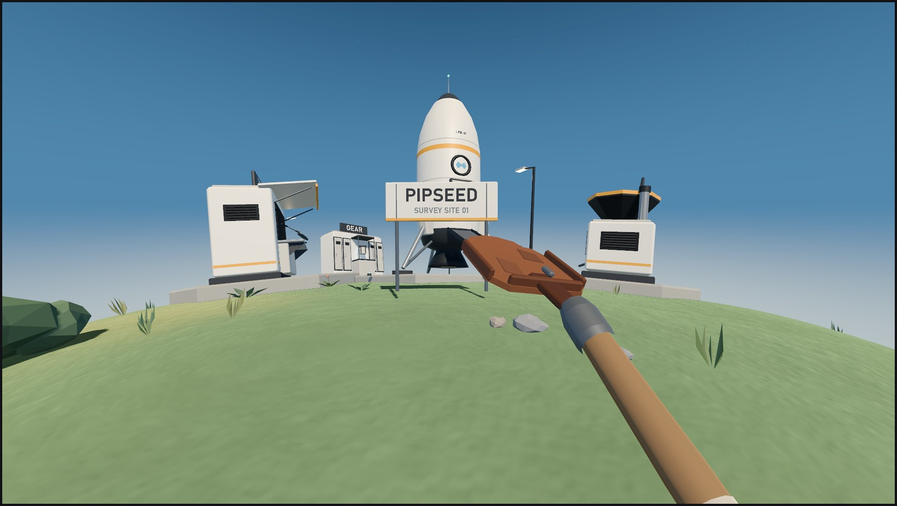
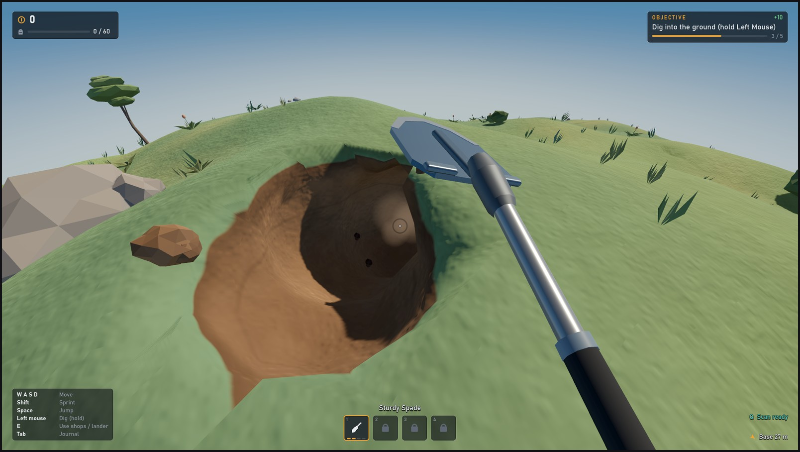
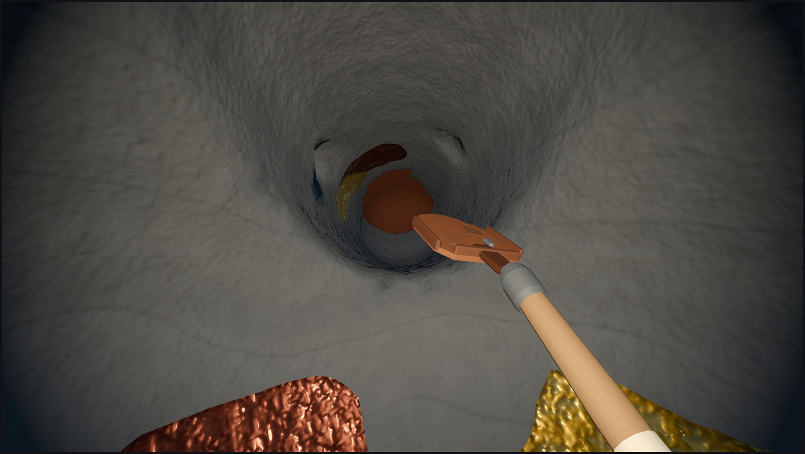
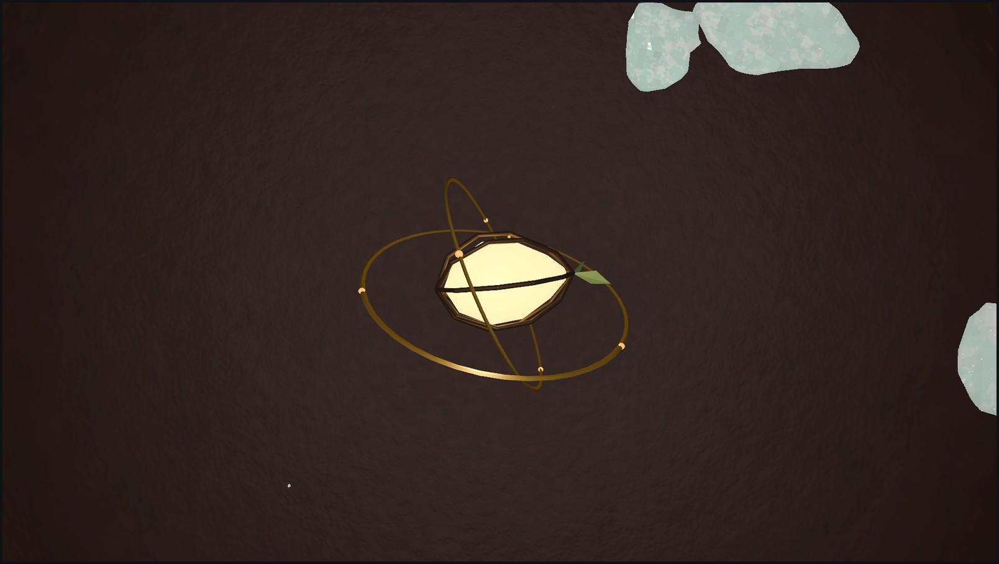
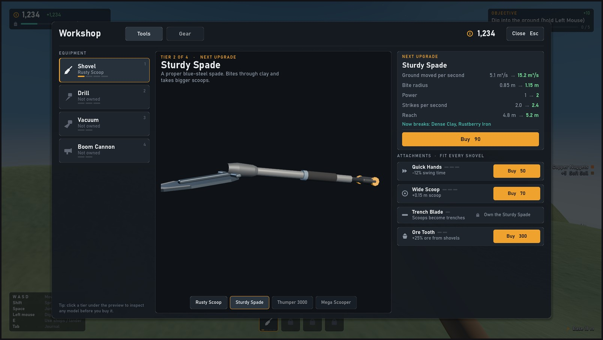
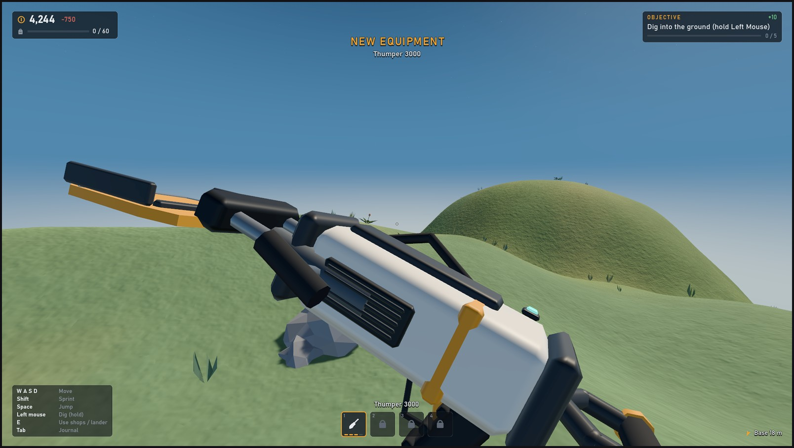
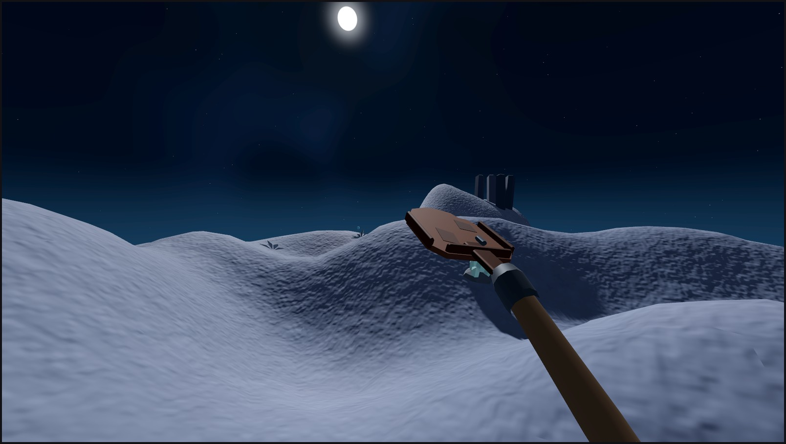
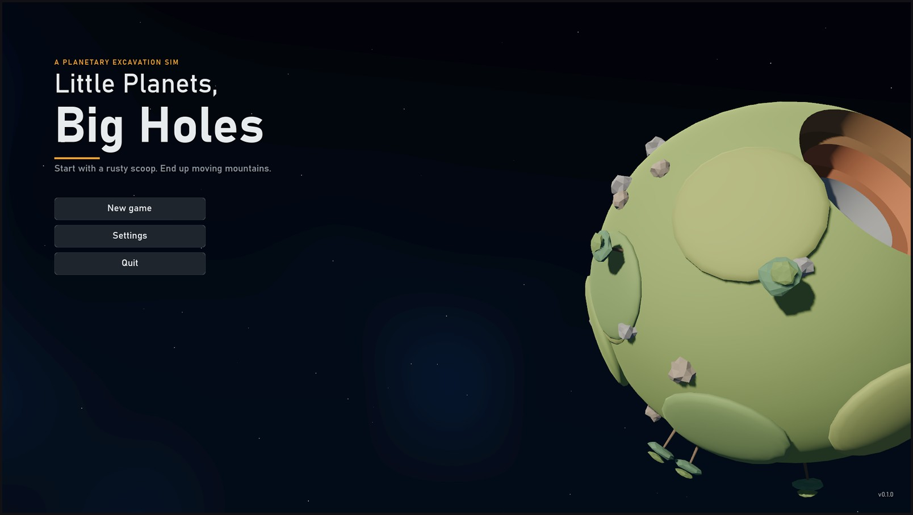
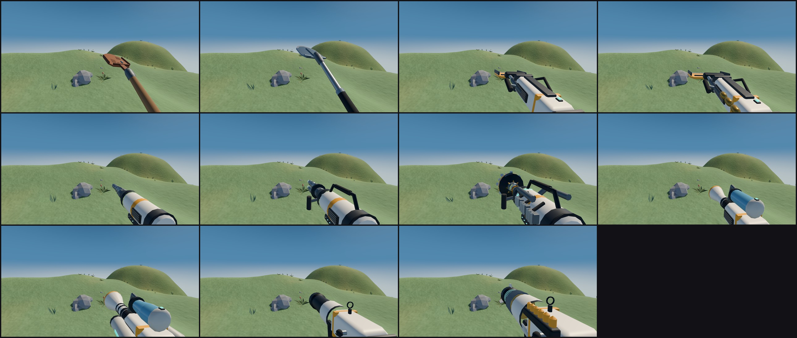
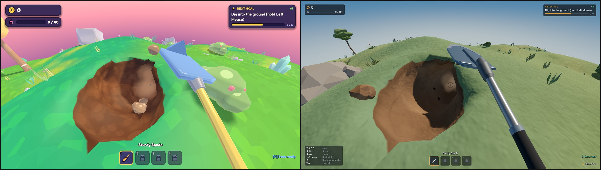

# Little Planets, Big Holes

A first-person incremental excavation sim for Godot 4. You land on a tiny, genuinely spherical
planet with a rusty hand scoop, dig real holes into fully deformable voxel terrain, sell what
you find at your outpost, and turn the credits into increasingly serious excavation equipment —
until you reach the planet's heart and fly on to the next world.

> **Status: v0.2.0 — visual identity and game-feel pass.** Two planets, four tool families
> (11 tiers, 12 attachments), 10 gear lines, 18 discoveries, helper bots, saving, a full
> menu/HUD/shop UI and 70 automated tests. The whole look was rebuilt in this pass: see
> [docs/ART_DIRECTION.md](docs/ART_DIRECTION.md) and the before/after sheets in
> [docs/screenshots/compare](docs/screenshots/compare). No human has playtested it yet —
> [docs/ROADMAP.md](docs/ROADMAP.md) lists exactly what was and was not verified.

## Screenshots

Rendered from the running game on an RTX 5070 by the scripted screenshot harness
(`tools/shots.sh`, Mobile renderer, 1920×1080).

| | |
|---|---|
|  |  |
|  |  |
|  |  |
|  |  |

Every tool tier has its own model, and every attachment adds parts to it:


Before and after this pass: 

## Requirements

| | |
|---|---|
| Engine | **Godot 4.7.2 stable** (standard build, not .NET) |
| Platforms | Windows x86_64 and Linux x86_64 (the vendored Voxel Tools binaries cover these two) |
| GPU | Anything that runs Godot's Vulkan *Mobile* renderer |

Nothing else needs to be installed to play. The terrain engine
([Zylann's Voxel Tools](https://github.com/Zylann/godot_voxel) 1.7, GDExtension build) is
vendored in `addons/zylann.voxel/` — see [docs/DEPENDENCIES.md](docs/DEPENDENCIES.md).
The developer tools additionally use Python 3 (standard library only, except
`tools/gen_audio.py`, which needs numpy).

## Running it

1. Clone the repository.
2. Open Godot 4.7.2 → **Import** → pick `project.godot`. The first import takes a moment.
   If the editor asks to restart after registering the GDExtension, let it.
3. Press **F5**.

Command line (set `GODOT` to your Godot executable; on Windows use Git Bash for the scripts):

```bash
"$GODOT" --headless --path . --import                     # one-time import
"$GODOT" --headless --path . res://tests/run_tests.tscn   # run the test suite
"$GODOT" --path .                                         # play
"$GODOT" --path . --rendering-method forward_plus         # play with the Forward+ renderer
```

### Building for Windows

Export presets for Windows and Linux are committed (`export_presets.cfg`; the JSON data files
are packaged explicitly). With the 4.7.2 export templates installed:

```bash
"$GODOT" --headless --path . --export-release "Windows Desktop" build/windows/LittlePlanetsBigHoles.exe
build/windows/LittlePlanetsBigHoles.exe --headless -- --smoke-test   # prints SMOKE OK, exit code 0
```

The build is the `.exe`, the `.pck` and `libvoxel.windows.template_release.x86_64.dll`
together. `build/` is not committed.

## Controls

| Action | Key |
|---|---|
| Move / look | `W A S D` / mouse |
| Sprint / jump | `Shift` / `Space` (double jump and jetpack are gear upgrades) |
| Use tool (hold) | Left mouse |
| Switch tool | `1`–`4` or mouse wheel |
| Interact (Workshop, Outfitter, lander, artifacts) | `E` |
| Scanner pulse | `Q` (needs the Pocket Pinger) |
| Field journal | `Tab` |
| Pause / settings | `Esc` |
| Performance overlay / quick save / screenshot | `F3` / `F5` / `F12` |

## How to play

* **Dig.** Hold the left mouse button. The ground is real volume: you can cut trenches, bore
  tunnels and hollow out hills, and it all stays that way.
* **Collect.** Chunks pop out and fly into your backpack. The HUD shows how full it is and
  what it is worth. When it is full, walk onto the green-edged pad of the **Depot** — everything
  sells instantly.
* **Upgrade.** Press `E` at the **Workshop** (tools) or the **Outfitter** (gear). Pick a tool
  family, look at any tier on the turntable, and read exactly what the next purchase changes —
  including how much ground it moves per second and which materials it starts to break.
  Hover an attachment to see it fitted before you pay.
* **Go deeper.** Layers get harder with depth. A tool that is too weak bounces off; if only
  *part* of a bite is too hard, the soft ground is removed and the tough ore is left standing
  proud for you to come back to.
* **Explore.** Cairns mark cave mouths; standing stones ring the mountains. Artifacts are
  sealed in pockets underground — the scanner finds them. Some discoveries unlock new shop
  items; two of them chart the course to the second planet. At the very centre of every planet
  hangs its Heart.

## What exists today

* Spherical voxel planets (Voxel Tools `VoxelTerrain` + Transvoxel), seeded and deterministic,
  with hills, mountains, basins, worm caves, hand-placed caverns with entrances, sealed
  artifact pockets and a hollow core chamber.
* Real excavation with material hardness, selective digging, sphere and capsule edits,
  immediate collision updates and persistent terrain (SQLite voxel stream per planet).
* First-person controller with planet-centred gravity, sprint, coyote time, double jump,
  jetpack, zero-g drifting inside the core and an "un-stick" safety net.
* Tools: Shovel (4 tiers), Drill (3), Vacuum (2), Boom Cannon (2); 12 attachments that change
  numbers, behaviour and the model.
* Gear: backpack, chunk magnet, boots, jump jets, scanner, lucky charm, refinery, helper bots,
  bot cargo, bot thrusters.
* An outpost that grows with your progress, a simulated and documented economy
  ([docs/BALANCE.md](docs/BALANCE.md)), 19 materials.
* Two planets: **Pipseed** (green starter world) and **Glimmerock** (airless low-gravity
  crystal moon), travel by lander.
* 18 discoveries, harvestable crystal formations, scanner, field journal, guided objectives.
* Main menu, HUD, shop with 3D previews, planet select, journal, pause, settings, loading.
* Versioned saves with checksum, atomic write, rolling backup and corrupted-save recovery.
* Original synthesised audio (49 effects + 2 music loops) with a level-normalised mix,
  depth-driven cave reverb and synthesised ambience.

Known limitations: [docs/ROADMAP.md](docs/ROADMAP.md#known-limitations).

## Repository layout

```
addons/zylann.voxel/   Voxel Tools 1.7 GDExtension (vendored, MIT)
assets/audio/          generated sound effects and music
data/                  ALL balance and content data (materials, tools, gear, planets, ...)
docs/                  art direction, balance, technical docs, roadmap, testing, screenshots
scenes/main.tscn       the only game scene; everything else is built in code
shaders/               terrain, prop/tool and sky shaders
src/autoload/          Settings, GameData, GameState, SaveSystem, Audio
src/core/              MeshKit (procedural modelling) and Pal (the model palette)
src/planet/            Geology (generation + materials), Planet, props, secrets
src/game/              World, DigSystem, FxManager, Scanner, Main
src/player/ src/tools/ player controller, tool controller, tool models
src/entities/ src/base/ pickups, formations, robots, the outpost
src/ui/                HUD, shop, menus, theme, icons, 3D tool preview
tests/                 headless test suites (run_tests.tscn)
tools/                 screenshot / benchmark / economy / audio tools (see docs/TESTING.md)
```

## Documentation

* [docs/ART_DIRECTION.md](docs/ART_DIRECTION.md) — the visual rulebook
* [docs/BALANCE.md](docs/BALANCE.md) — pacing targets, the economy simulator and its assumptions
* [docs/TECHNICAL.md](docs/TECHNICAL.md) — terrain, excavation, rendering, performance, saving
* [docs/TESTING.md](docs/TESTING.md) — tests, screenshot harness, benchmarks, what was verified
* [docs/DEPENDENCIES.md](docs/DEPENDENCIES.md) — Voxel Tools install/update, versions, licences
* [docs/ROADMAP.md](docs/ROADMAP.md) — known limitations and what comes next
* [CLAUDE.md](CLAUDE.md) — orientation for AI coding agents working in this repo

## Licence & credits

Game code and data: © the project authors. Third-party components and their licences are listed
in [THIRD_PARTY_NOTICES.md](THIRD_PARTY_NOTICES.md).
