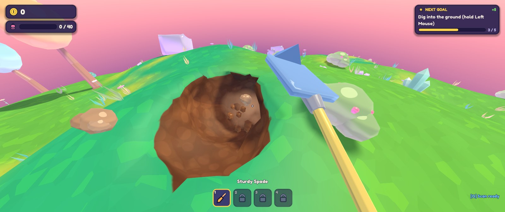
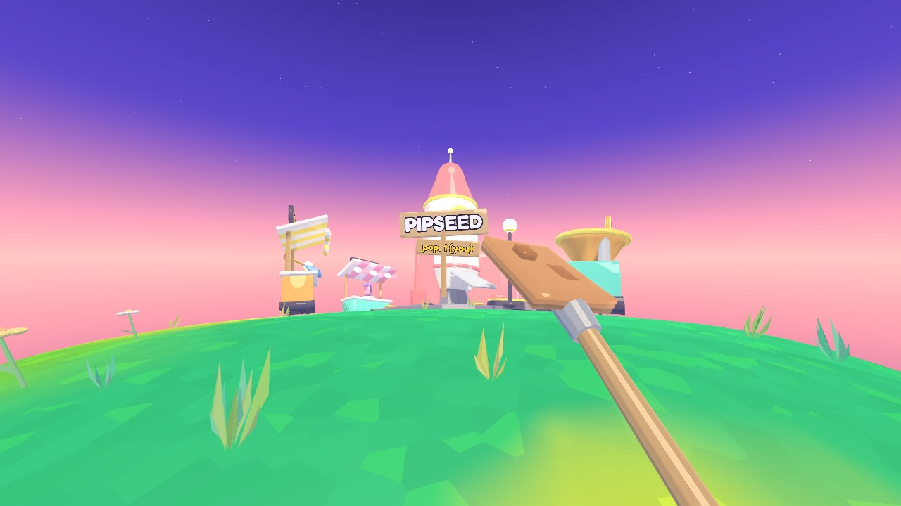
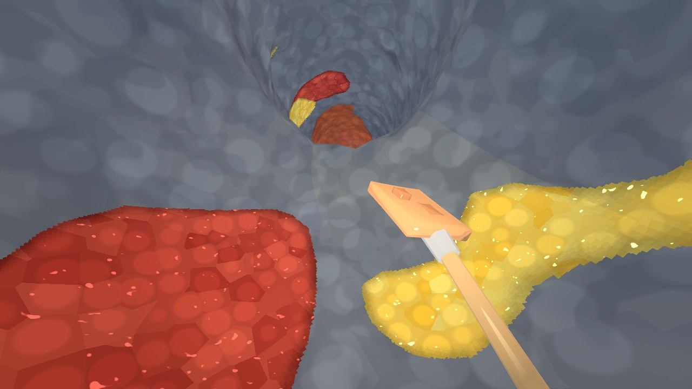
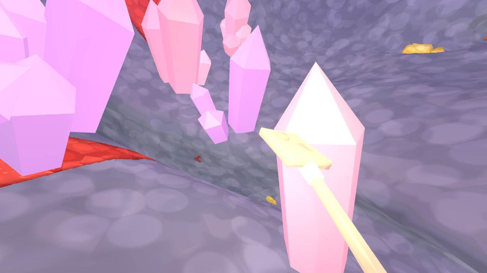
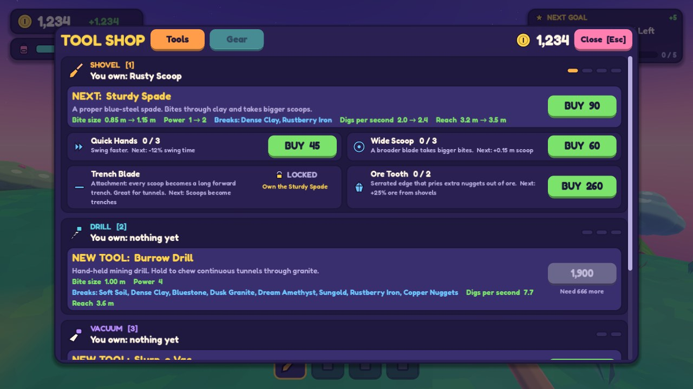
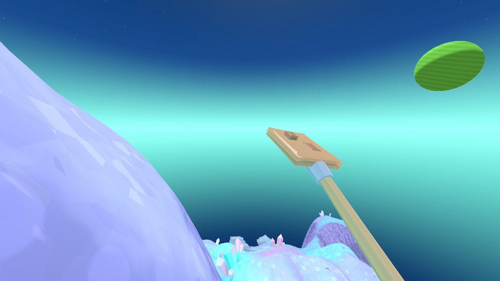
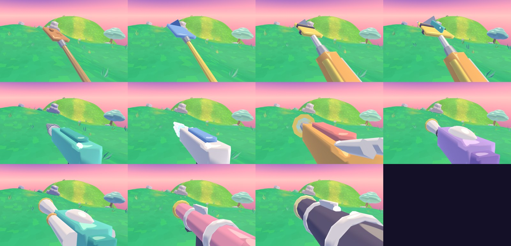

# Little Planets, Big Holes

A first-person incremental excavation game for Godot 4. You land on a tiny, colourful,
genuinely spherical planet with a rusty scoop, dig real holes into fully deformable voxel
terrain, sell what you find, and turn the credits into bigger and sillier digging machinery —
until you reach the planet's heart and fly on to the next world.

> **Status: first playable (v0.1.0).** Two planets, four tool families (11 tiers, 12 mods),
> 10 gear lines, 18 discoveries, helper bots, saving, a full menu/HUD/shop UI and 63 automated
> tests. See [What exists today](#what-exists-today) and [docs/ROADMAP.md](docs/ROADMAP.md).

## Screenshots

Rendered from the actual game by the scripted screenshot harness (`tools/shots.sh`) on a
software rasteriser — a real GPU will look the same but run at a playable frame rate.

| | |
|---|---|
|  |  |
|  |  |
|  |  |

Every tool tier has its own model: 

## Requirements

| | |
|---|---|
| Engine | **Godot 4.7.2 stable** (standard build, not .NET) |
| Platforms | Windows x86_64 and Linux x86_64 (the vendored Voxel Tools binaries cover these two) |
| GPU | Anything that runs Godot's Vulkan *Mobile* renderer |

Nothing else needs to be installed. The terrain engine
([Zylann's Voxel Tools](https://github.com/Zylann/godot_voxel) 1.7, GDExtension build) is
already vendored in `addons/zylann.voxel/` — see [docs/DEPENDENCIES.md](docs/DEPENDENCIES.md).

## Running it

1. Clone the repository.
2. Open Godot 4.7.2 → **Import** → pick `project.godot`.
   The first import takes a moment (it imports fonts/audio and loads the voxel extension).
   If the editor asks to restart after registering the GDExtension, let it.
3. Press **F5**.

Headless / command line (Linux, also how CI runs it):

```bash
godot --headless --path . --import                     # one-time import
godot --headless --path . res://tests/run_tests.tscn   # run the test suite
godot --path .                                         # play
```

## Controls

| Action | Key |
|---|---|
| Move / look | `W A S D` / mouse |
| Sprint / jump | `Shift` / `Space` (double jump and jetpack are gear upgrades) |
| Use tool (hold) | Left mouse |
| Switch tool | `1`–`4` or mouse wheel |
| Interact (shops, rocket, artifacts) | `E` |
| Scanner pulse | `Q` (needs the Pocket Pinger) |
| Journal & stats | `Tab` |
| Pause / settings | `Esc` |
| Debug overlay / quick save / screenshot | `F3` / `F5` / `F12` |

## How to play

* **Dig.** Hold the left mouse button. The ground is real volume: you can cut trenches, bore
  tunnels and hollow out hills, and it all stays that way.
* **Collect.** Chunks pop out and fly into your backpack. When it is full, walk onto the green
  pad of the **Sell-o-Matic** next to the rocket — everything sells instantly.
* **Upgrade.** Press `E` at the **Tools** or **Gear** kiosk. Each card shows exactly what
  changes (`0.85 m → 1.15 m`), what it costs and, if it is locked, why.
* **Go deeper.** Layers get harder with depth. A tool that is too weak bounces off with a clang;
  if only *part* of a bite is too hard, the soft ground is removed and the tough ore is left
  standing proud for you to come back to.
* **Explore.** Hillside cave mouths lead to hidden caverns. Artifacts are sealed in pockets
  underground — the scanner finds them. Some discoveries unlock new shop items; two of them
  chart the course to the second planet. At the very centre of every planet floats its Heart.

## What exists today

**Fully playable**

* Spherical voxel planets (Voxel Tools `VoxelTerrain` + Transvoxel), seeded and deterministic,
  with hills, mountains, basins, worm caves, hand-placed caverns with entrances, sealed
  artifact pockets and a hollow core chamber.
* Real excavation with material hardness, selective digging, sphere and capsule (trench/tunnel)
  edits, immediate collision updates and persistent terrain (SQLite voxel stream per planet).
* First-person controller with planet-centred gravity, smooth re-orientation, sprint, coyote
  time, double jump, jetpack, zero-g drifting inside the core, and an "un-stick" safety net.
* Tools: Shovel (4 tiers), Drill (3), Vacuum (2), Boom Cannon (2), each tier with its own
  procedural model; 12 mods that change numbers *and* behaviour (trench blade, fracture bit…)
  and add visible parts to the model.
* Gear: backpack, chunk magnet, boots, jump jets, scanner, lucky charm, refinery, helper bots,
  bot cargo, bot thrusters.
* Economy: 19 materials, sell station with animated payout, data-driven prices in `data/*.json`.
* Two planets: **Pipseed** (soft starter world) and **Glimmerock** (low-gravity crystal moon,
  different strata, tougher crust), travel by rocket.
* 18 discoveries (artifacts, places, planet hearts), harvestable crystal formations, scanner
  with through-rock ore highlighting, discovery journal, guided objective chain.
* Helper bots ("Scoopy") that haul loose chunks to the Sell-o-Matic.
* Main menu, HUD, shop, planet select, journal, pause, settings (sensitivity, FOV, shake, bob,
  UI scale, volumes, fullscreen, v-sync, render scale, shadows), loading screen.
* Versioned saves with checksum, atomic write, rolling backup and corrupted-save recovery.
* Original synthesised audio (49 effects + 2 music loops, generated by `tools/gen_audio.py`).

**Partial / known limitations** — see [docs/ROADMAP.md](docs/ROADMAP.md#known-limitations).

## Repository layout

```
addons/zylann.voxel/   Voxel Tools 1.7 GDExtension (vendored, MIT)
assets/                fonts (Fredoka, OFL) and generated audio
data/                  ALL balance and content data (materials, tools, gear, planets, ...)
docs/                  technical docs, roadmap, testing, dependencies
scenes/main.tscn       the only scene; everything else is built in code
shaders/               terrain, prop/tool, sky shaders + shared toon lighting
src/autoload/          Settings, GameData, GameState, SaveSystem, Audio
src/planet/            Geology (generation + materials), Planet, props, secrets
src/game/              World, DigSystem, FxManager, Scanner, Main
src/player/ src/tools/ player controller, tool controller, tool models
src/entities/ src/base/ pickups, formations, robots, rocket base
src/ui/                HUD and every menu
tests/                 headless test suites (run_tests.tscn)
tools/                 audio generator, compile check, screenshot + benchmark harnesses
```

## Documentation

* [docs/TECHNICAL.md](docs/TECHNICAL.md) — terrain generation, excavation, rendering, saving,
  performance numbers, multiplayer notes
* [docs/DEPENDENCIES.md](docs/DEPENDENCIES.md) — Voxel Tools install/update, versions, licences
* [docs/TESTING.md](docs/TESTING.md) — running and writing tests, screenshot harness
* [docs/ROADMAP.md](docs/ROADMAP.md) — known limitations and what comes next
* [CLAUDE.md](CLAUDE.md) — orientation for AI coding agents working in this repo

## Licence & credits

Game code and data: © the project authors. Third-party components and their licences are listed
in [THIRD_PARTY_NOTICES.md](THIRD_PARTY_NOTICES.md).
